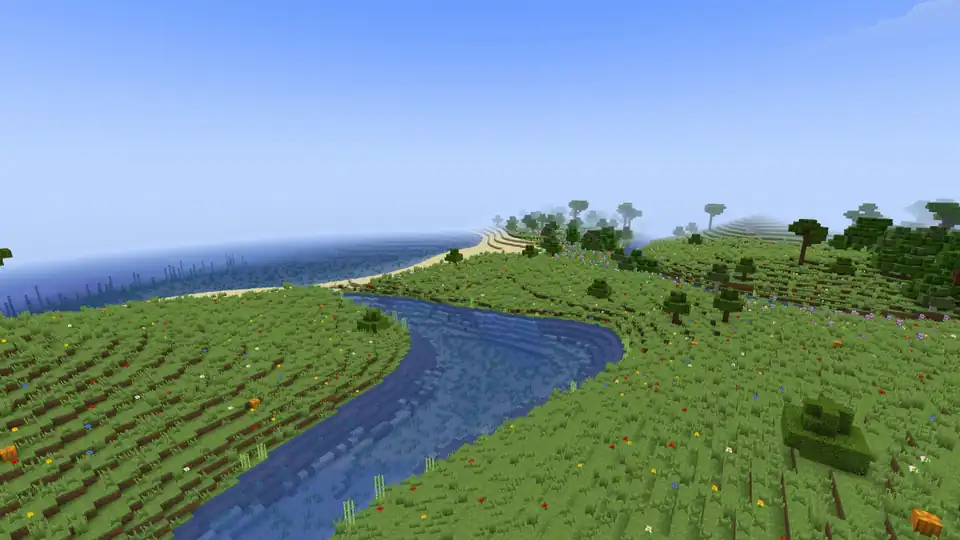
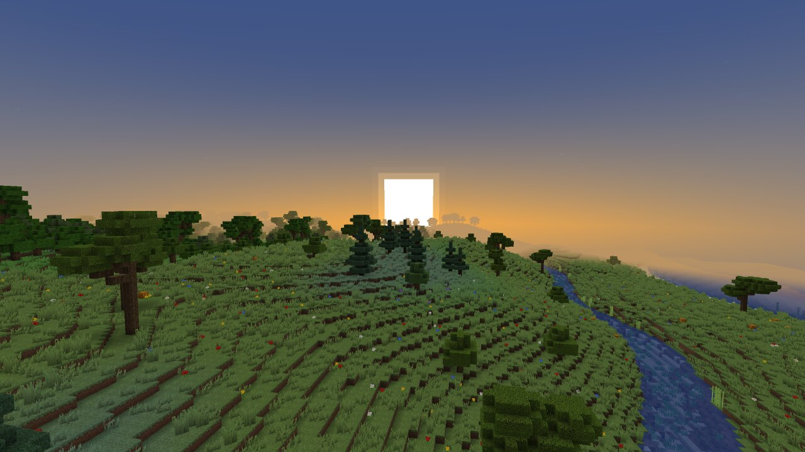
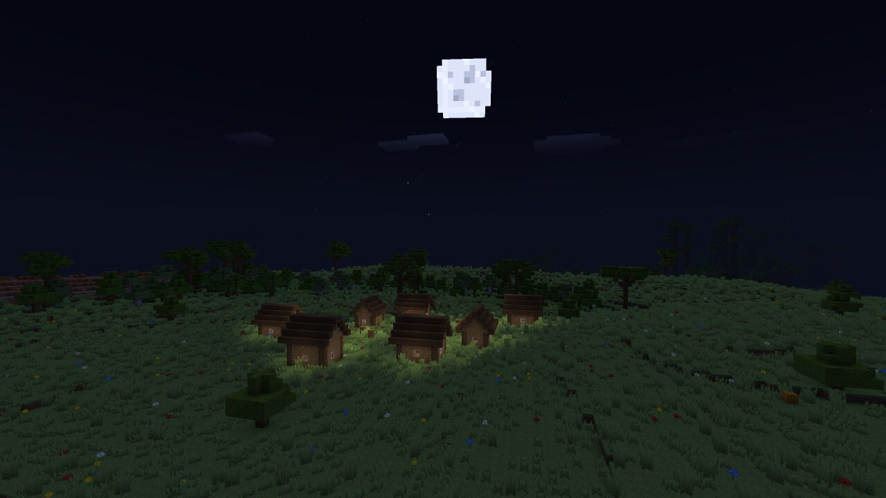
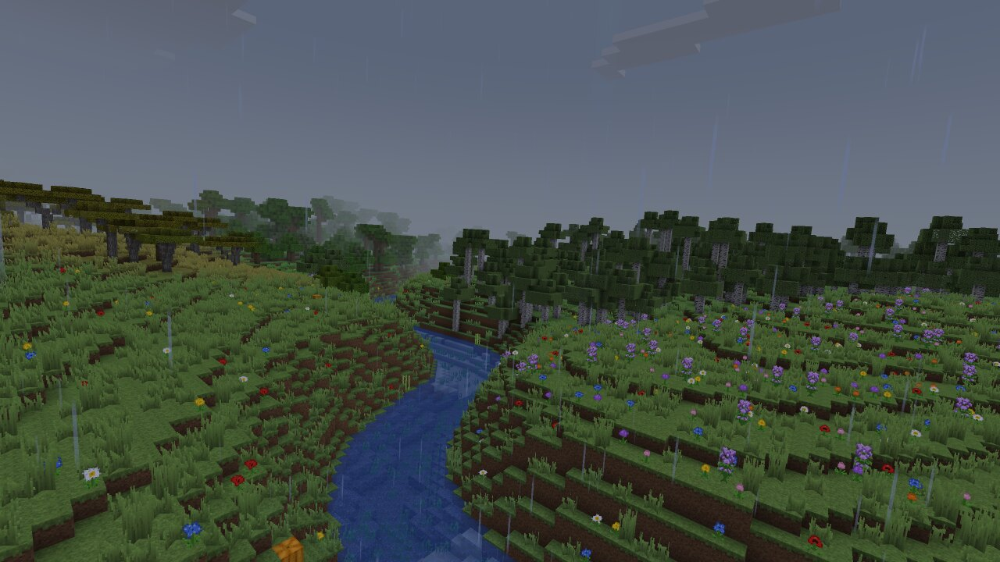
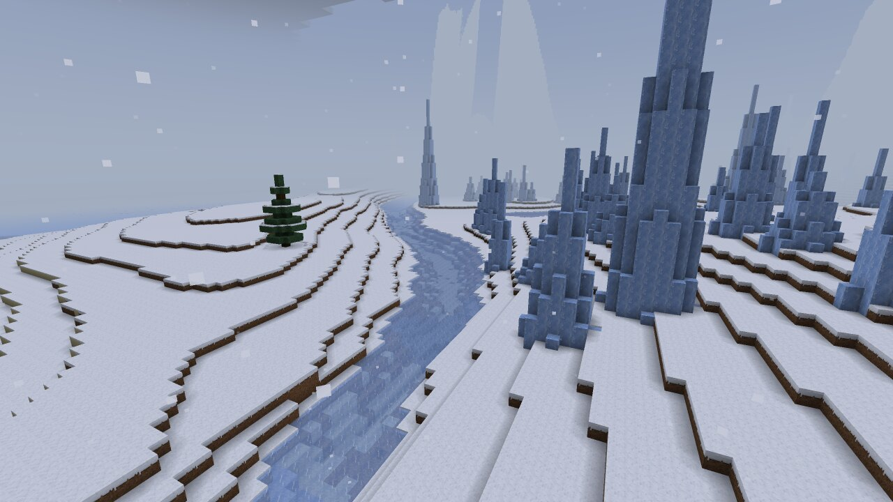
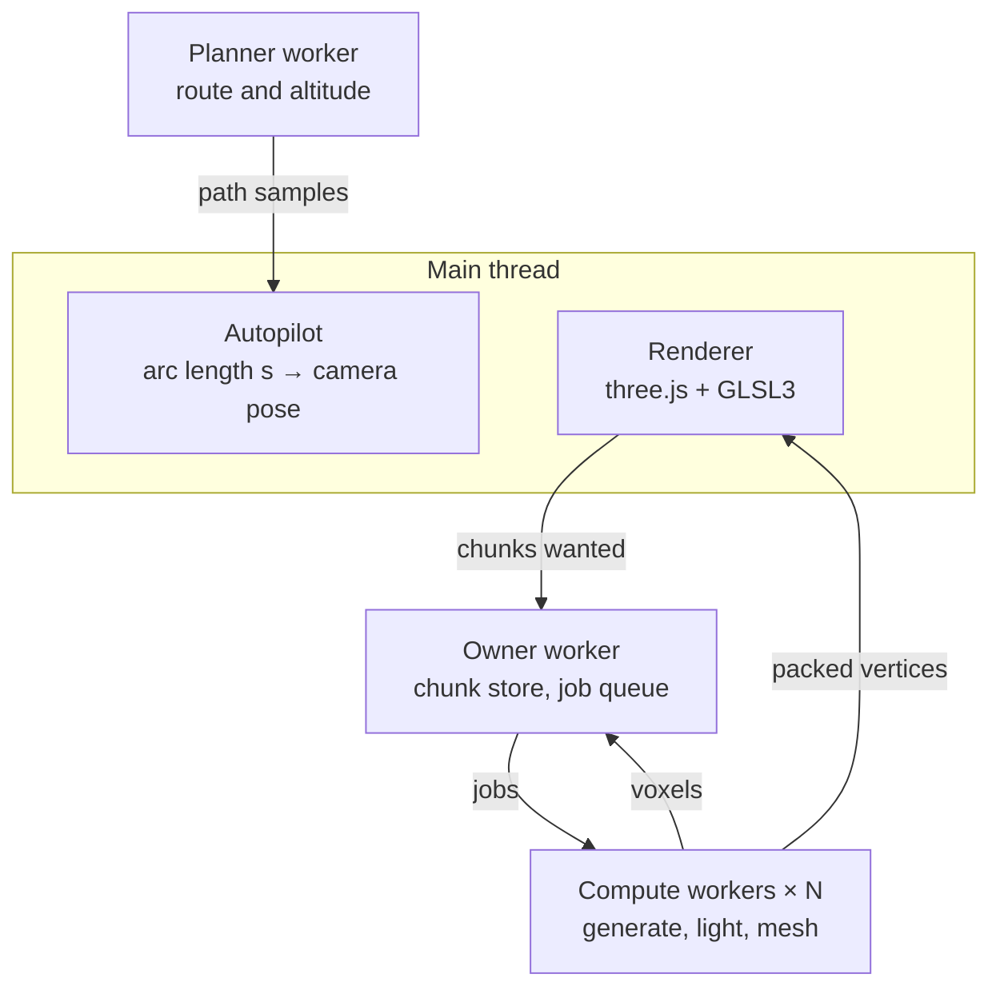

<div align="center">

<a href="https://endless-blocks.ponyo877.com"></a>

<h1>Endless Blocks</h1>

<p><strong>A never-ending autopilot flight over an infinite, procedurally generated block world.</strong><br>
Open it, lean back, and watch. It runs in your browser, forever.</p>

<p>
<a href="https://endless-blocks.ponyo877.com"></a>
<a href="https://github.com/ponyo877/endless-blocks/actions/workflows/pages.yml"></a>
<a href="LICENSE"></a>


</p>

<p>
<a href="https://endless-blocks.ponyo877.com"><b>Launch</b></a>
&nbsp;·&nbsp;
<a href="#demo">Demo</a>
&nbsp;·&nbsp;
<a href="#how-it-works">How it works</a>
&nbsp;·&nbsp;
<a href="#development">Development</a>
</p>

</div>

## Highlights

- **Infinite and reproducible.** Every seed is its own world. Terrain, biomes, caves, trees and villages are pure functions of the seed and the position, so a shared link always replays the same flight.
- **38 biomes.** A multi-noise climate model (temperature, humidity, continentalness, erosion, weirdness) drives 3D density terrain, cheese and spaghetti caves, rivers, oceans, and small villages, desert pyramids and ruined watchtowers.
- **A camera that never crashes.** A planner worker looks ahead with a beam search that favours valleys, rivers and coastlines, and keeps the camera above every block, tree and roof. Fly backwards and it retraces the exact same path.
- **Classic look, original art.** Smooth lighting and ambient occlusion, biome tints, animated water, 3D clouds, fog, a pixel-art sun and moon, a day–night cycle, rain, thunderstorms and snow.
- **Zero assets.** Every texture and sound is generated in code at startup. The whole app is about 220 kB of gzipped JavaScript.
- **Smooth for hours.** Generation and meshing run on Web Workers, and frames are paced to whole display refreshes. Under load it settles at a steady lower frame rate before it touches resolution or draw distance.

## Demo

https://github.com/user-attachments/assets/2bc1ce30-9ed6-40be-9376-1f0f27841912

<table>
  <tr>
    <td width="50%" align="center"><br><sub>Golden hour</sub></td>
    <td width="50%" align="center"><br><sub>A village at night</sub></td>
  </tr>
  <tr>
    <td width="50%" align="center"><br><sub>Thunderstorm</sub></td>
    <td width="50%" align="center"><br><sub>Ice spires in the snow</sub></td>
  </tr>
</table>

All footage is rendered by the app itself. Try the same places with [`?seed=31415`](https://endless-blocks.ponyo877.com/?seed=31415).

## Controls

| Input | Action |
| --- | --- |
| <kbd>Space</kbd> | Play / pause |
| <kbd>↑</kbd> / <kbd>↓</kbd> (hold) | Speed up / slow down, then fly backwards |
| Mouse wheel | Fine-tune the speed |
| Speed slider | Left of centre flies backwards. Double-click resets to 8 blocks/s |
| <kbd>F</kbd> | Fullscreen |
| <kbd>M</kbd> | Ambient sound (off by default) |
| <kbd>H</kbd> | Hide the UI |
| <kbd>N</kbd> | New world |
| <kbd>I</kbd> | Debug overlay |

### URL parameters

| Parameter | Description | Default |
| --- | --- | --- |
| `seed` | World seed. The same seed gives the same world and the same flight | random |
| `speed` | Initial speed in blocks/s. Negative values fly backwards | `8` |
| `rd` | Render distance in chunks (4–24) | `12` |
| `daylen` | Length of one day in seconds | `1200` |
| `time` | Start time of day: `0` sunrise, `0.25` noon, `0.5` sunset | `0.08` |
| `debug` | Show the debug overlay | — |

For example, [`?seed=31415&speed=24&time=0.45`](https://endless-blocks.ponyo877.com/?seed=31415&speed=24&time=0.45) flies faster towards an evening sky.

## How it works



| Part | What it does |
| --- | --- |
| **World generation**<br>[`src/gen`](src/gen) | Seeded Perlin noise feeds five climate parameters that pick a biome. Splines turn them into a 3D density field, sampled on a 4×8×4 lattice and interpolated, then carved by caves and dressed with surface rules, trees, plants and structures. Everything is deterministic and order-independent. |
| **Streaming**<br>[`src/workers`](src/workers) | The owner worker stores compressed chunks and schedules jobs by distance along the flight path. Compute workers generate chunks, then light and mesh each one from its 3×3 neighbourhood. The main thread never touches voxels; it only receives packed 12-byte vertices. |
| **Autopilot**<br>[`src/autopilot`](src/autopilot) | The route depends only on the seed and the distance flown. It is smoothed into a C²-continuous B-spline, and its altitude profile clears every block in a corridor around the path. The camera state is a single float64 `s`, so reversing retraces the flight exactly. |
| **Rendering**<br>[`src/render`](src/render) | Chunk faces are grouped by direction, and only the directions that can face the camera are drawn, in one `WEBGL_multi_draw` call. Chunks are culled by their bounding boxes. The sky is drawn last at the far plane, so the GPU skips every pixel hidden by terrain. |
| **Frame pacing**<br>[`quality.ts`](src/render/quality.ts) | Frame times are rounded to whole display refreshes, which removes judder from `requestAnimationFrame` jitter. Under load it first renders every other refresh, and only then lowers resolution and render distance. |

## Development

Requires Node.js 22 or later and a browser with WebGL 2.

```sh
npm install
npm run dev        # http://localhost:5173
npm test           # determinism, meshing, path safety and frame pacing
npm run build      # static site in dist/, no special headers needed
npm run preview    # serve the build
```

Every push to `main` is tested, built and deployed to GitHub Pages by [`pages.yml`](.github/workflows/pages.yml).

<details>
<summary><b>Profiling</b></summary>

<br>

Add `bench=N` to record N seconds of frames with fixed time and weather. Recording starts 3 seconds after the world is ready. The summary goes to `window.__benchResult` and to the console under `[bench]`.

```
http://localhost:5173/?seed=12345&speed=16&bench=30&time=0.15
```

It reports frame-interval percentiles, stutter counts (over 20, 33, 50 and 100 ms), CPU time per stage, upload volume, draw calls, triangles, GC and long tasks.

| Parameter | Effect |
| --- | --- |
| `exp=freeze` | Stop the camera when recording starts, to measure one spot |
| `exp=nochunks` / `exp=noclouds` | Skip terrain / clouds |
| `exp=pacer` | Keep frame pacing on during the benchmark (off by default) |
| `exp=burn22` | Waste 22 ms of CPU per frame to emulate a slow machine |
| `workers=N` | Fix the number of compute workers |
| `gpusync` | Wait for the GPU after each frame and record GPU time (breaks pipelining; for comparison only) |

`exp` flags combine with commas, for example `exp=pacer,burn22`. `npx tsx scripts/scene-quads.ts [seed] [x] [z] [r]` meshes the chunks around a point exactly as the app does and counts faces per pass.

</details>

## Acknowledgements

Inspired by the endless zoom of [organiccity.org](https://organiccity.org/). Endless Blocks is an independent project. All of its textures, names and sounds are original and generated in code; it ships no third-party game assets.

## License

[MIT](LICENSE) © ponyo877
